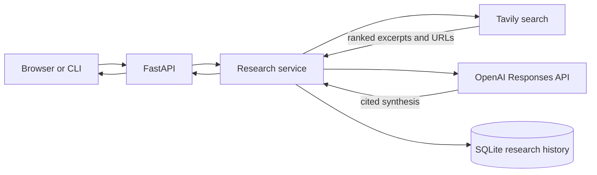

# Deep Research Agent

**Turn a question into a source-grounded research brief.** Search the web, compare evidence, and read a synthesized report with citations you can trace back to the original source.

[](https://github.com/DivyanBabbar/deep-research-agent/actions/workflows/quality.yml)  

## Product overview

Fieldnotes is a research desk for people who need more than a pile of search results. Ask a question, choose a quick scan or in-depth search, and receive a structured report with inline source references, an evidence trail, and a Markdown export. Completed runs are saved in a local SQLite database so you can return to them later.

**Designed for:** researchers, analysts, students, and product teams exploring a topic before making a decision.

### What it does

- Searches the web using Tavily and captures relevant source excerpts.
- Synthesizes the evidence using the OpenAI Responses API, with instructions to cite claims and flag gaps or disagreement.
- Shows source cards with original links and retrieval match scores.
- Persists reports and makes them available through an API and recent-history panel.
- Exports each report and its bibliography as Markdown.
- Offers a responsive browser interface and a CLI.

## Demo

Open `http://127.0.0.1:8000`, choose one of the suggested questions, and select **Build my brief**. The app searches sources, compares their evidence, and shows a cited report beside the source cards. Use **Download Markdown** to export the report, or select a previous run in the left history panel. API documentation is available at `/docs`.

## Architecture



The provider boundary is intentionally small: search and synthesis happen in the service layer, while API, CLI, and web UI share the same validated request and response models.

## Quick start

Requires Python 3.11 or newer and API keys from [Tavily](https://tavily.com/) and [OpenAI](https://platform.openai.com/).

```bash
python -m venv .venv
# Windows PowerShell: .venv\Scripts\Activate.ps1
# macOS/Linux:
source .venv/bin/activate
pip install -e ".[dev]"
cp .env.example .env
```

Add `TAVILY_API_KEY` and `OPENAI_API_KEY` to `.env`, then start the service:

```bash
uvicorn research_agent.api:app --reload --app-dir src
```

Open **http://127.0.0.1:8000** for the web app or **http://127.0.0.1:8000/docs** for interactive API docs.

### CLI

```bash
research-agent "How are cities adapting to extreme heat?" --depth advanced --max-results 8
```

## Docker Compose

```bash
cp .env.example .env
# Add provider keys, then:
docker compose up --build
```

Compose keeps research history in a named Docker volume. For local development without containers, the default database file is `data/research.db`.

## API reference

| Method | Endpoint | Purpose |
| --- | --- | --- |
| `GET` | `/health` | Liveness check; does not call paid providers |
| `POST` | `/research` | Search and synthesize a brief |
| `GET` | `/history?limit=20` | List recent completed briefs (limit 1–100) |
| `GET` | `/research/{run_id}` | Retrieve a saved report and its evidence |
| `GET` | `/docs` | Interactive OpenAPI reference |

Example request:

```json
{
  "query": "How are cities adapting to extreme heat?",
  "depth": "advanced",
  "max_results": 8
}
```

The response includes a unique `run_id`, UTC timestamp, report, and source records. Citations such as `[S1]` map to the matching source record in `sources`.

## Configuration

| Variable | Default | Description |
| --- | --- | --- |
| `OPENAI_API_KEY` | — | Required for report synthesis |
| `OPENAI_MODEL` | `gpt-4.1-mini` | OpenAI model used for synthesis |
| `TAVILY_API_KEY` | — | Required for web search |
| `MAX_RESULTS` | `8` | Default source count for API and CLI clients |
| `REQUEST_TIMEOUT_SECONDS` | `45` | OpenAI request timeout |
| `DATABASE_PATH` | `data/research.db` | SQLite database path |
| `ENVIRONMENT` | `development` | Label returned by the health endpoint |
| `LOG_LEVEL` | `INFO` | Python logging level |

The API validates source count between 1 and 20. Reports and evidence are retained in SQLite at the configured path.

## Quality and development

```bash
pip install -e ".[dev]"
ruff check .
ruff format --check .
pytest -q
```

GitHub Actions runs lint, formatting checks, and offline provider-mocked tests on pushes and pull requests. Tests do not require API keys or make network calls.

## Security and research limitations

- Never commit `.env` or provider keys. Use a secrets manager for deployments.
- Retrieved web text is untrusted and may be incomplete, stale, or adversarial. The synthesis prompt treats source text as evidence, not instructions, but this is not a perfect prompt-injection defense.
- A citation indicates which retrieved source informed the report; it does not prove a claim is correct. Verify important statements against the original page.
- Reports, queries, and retrieved excerpts are stored locally in SQLite. Protect the database and volume if research may be sensitive.
- This project has no authentication or per-user tenancy. Put it behind an authenticated gateway before exposing it to multiple users or the public internet.

See [SECURITY.md](SECURITY.md) for reporting guidance.

## Resume-ready project summary

> Built a full-stack AI research assistant with FastAPI, Tavily web search, OpenAI Responses synthesis, citation-linked evidence, persistent SQLite history, Markdown export, Docker deployment, and CI with offline provider-mocked tests.

**Skills demonstrated:** Python, FastAPI, REST/OpenAPI, retrieval and synthesis workflows, prompt design, Pydantic validation, SQLite, responsive frontend development, Docker, GitHub Actions, testing, and secure configuration.

## Roadmap

- [ ] Add authentication and per-user workspaces.
- [ ] Add background jobs and progress streaming for long-running research.
- [ ] Add source allow/block lists and configurable source quality controls.
- [ ] Evaluate citation coverage and evidence agreement automatically.

## License

MIT. See [LICENSE](LICENSE).
